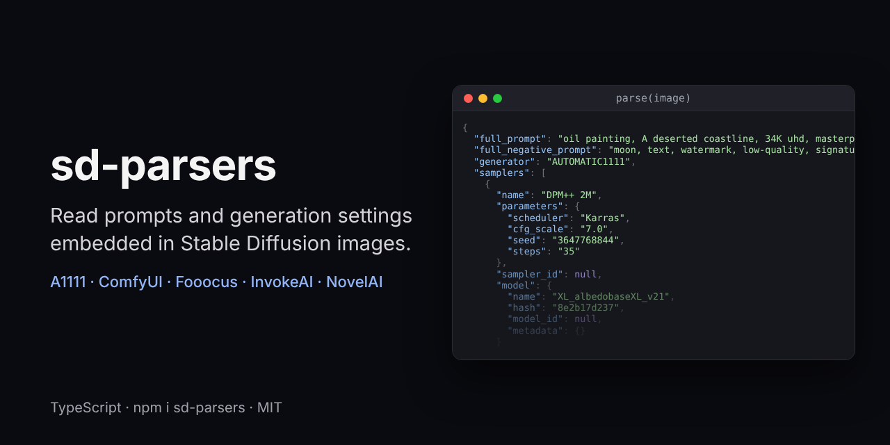

# SD-Parsers


Read structured metadata from images created with stable diffusion.

A TypeScript package for extracting prompt information and generation parameters for AI-generated images. You need images that are already embedded with generation data to use this library, it does not "predict" anything.

Website & API: https://sd-parsers.vercel.app/ (drop an image to read its metadata; parsing happens in your browser). Source in [`web/`](web/README.md).

> **Note**: This started as a TypeScript port of the Python [sd-parsers](https://github.com/d3x-at/sd-parsers) library. It keeps output parity with the Python version (checked by tests) and adds async/await, full TypeScript types and a few parsing improvements.



## Features

Prompts, models, samplers and other well-known generation parameters are provided as easily accessible properties.

Supports reading metadata from images generated with:

| Generator | Parser |
| --- | --- |
| Automatic1111's Stable Diffusion web UI (and forks using its format) | `AUTOMATIC1111Parser` |
| Fooocus | `FooocusParser` |
| ComfyUI | `ComfyUIParser` |
| InvokeAI | `InvokeAIParser` |
| NovelAI | `NovelAIParser` |

Metadata is read from:

* **PNG**: `tEXt`, `zTXt` and `iTXt` chunks, including text stored after the image data
* **JPEG / WEBP**: the EXIF `UserComment` field
* **PNG alpha channel**: "stealth" metadata (NovelAI and the A1111 stealth-pnginfo extension), at `Eagerness.EAGER`

## Installation

```bash
npm install sd-parsers
```

Requires Node.js 18.17 or newer, or any modern browser / JavaScript runtime (Deno, Bun, edge functions).

The metadata is read straight from the file contents, without decoding the image. [sharp](https://sharp.pixelplumbing.com/) is an optional dependency, only used in Node.js to decode pixels for stealth metadata (`Eagerness.EAGER`). Install with `npm install sd-parsers --omit=optional` to skip it; everything else keeps working.

## Command Line Usage

You can use sd-parsers from the command line to quickly print the metadata of one or more images:

```bash
npx sd-parsers image1.png image2.jpg
```

For each image this prints the models, samplers with their parameters, the prompt, the negative prompt and any other metadata found.

## Usage

### Basic usage

Import `ParserManager` from `sd-parsers` and call its `parse()` method. It accepts a file path (Node.js only), the file contents as a `Buffer`, `Uint8Array` or `ArrayBuffer`, a `Blob` / `File`, or a `sharp` instance, and resolves to a `PromptInfo` object, or `null` when no known metadata is found.

#### Read prompt information from a file:

```typescript
import { ParserManager, getFullPrompt, getFullNegativePrompt, getModels } from 'sd-parsers';

const parserManager = new ParserManager();

async function main() {
  const promptInfo = await parserManager.parse('image.png');

  if (promptInfo) {
    console.log(`Generator: ${promptInfo.generator}`);
    console.log(`Prompt: ${getFullPrompt(promptInfo)}`);
    console.log(`Negative prompt: ${getFullNegativePrompt(promptInfo)}`);

    for (const model of getModels(promptInfo)) {
      console.log(`Model: ${model.name ?? model.hash}`);
    }

    for (const sampler of promptInfo.samplers) {
      console.log(`Sampler: ${sampler.name}`, sampler.parameters);
    }
  }
}
```

#### Read prompt information from a Buffer:

```typescript
import { ParserManager } from 'sd-parsers';
import { readFile } from 'fs/promises';

const parserManager = new ParserManager();

async function main() {
  const imageBuffer = await readFile('image.png');
  const promptInfo = await parserManager.parse(imageBuffer);

  if (promptInfo) {
    console.log(promptInfo);
  }
}
```

#### Read prompt information in the browser:

```typescript
import { ParserManager, Eagerness } from 'sd-parsers';

const parserManager = new ParserManager();

input.addEventListener('change', async () => {
  const promptInfo = await parserManager.parse(input.files[0], Eagerness.EAGER);
  console.log(promptInfo);
});
```

In browsers, stealth metadata is decoded with a canvas (`createImageBitmap` and `OffscreenCanvas`). To use another decoder, or when neither sharp nor a canvas is available, pass `decodePixels`, which resolves to raw, interleaved pixels:

```typescript
const promptInfo = await parserManager.parse(bytes, {
  eagerness: Eagerness.EAGER,
  decodePixels: async () => ({ data, width, height, channels: 4 }),
});
```

Without a pixel decoder, stealth metadata is skipped and the other metadata is still read.

Pass a file path or the file contents to get all metadata. When a `sharp` instance is passed, the original file contents are not available, so text chunks stored after the image data cannot be told apart from the ones before it.

### Parsing options

#### Configure metadata extraction:

```typescript
import { ParserManager, Eagerness } from 'sd-parsers';

const parserManager = new ParserManager({ eagerness: Eagerness.EAGER });

// or per call
const promptInfo = await parserManager.parse('image.png', Eagerness.FAST);
```

`Eagerness` sets the metadata searching effort:

- **FAST**: cut some corners to save some time (PNG text chunks before the image data, JPEG / WEBP `UserComment`)
- **DEFAULT**: try to ensure all metadata is read (all PNG text chunks; default)
- **EAGER**: include additional methods to try and retrieve metadata, such as stealth metadata in the alpha channel (computationally expensive!)

#### Only use specific parser modules:

```typescript
import { ParserManager, AUTOMATIC1111Parser } from 'sd-parsers';

const parserManager = new ParserManager({
  managedParsers: [AUTOMATIC1111Parser]
});
```

#### Keep the original parameter names:

By default, parameter names are normalized (for example `cfg_scale`, `steps`, `seed`). Turn this off to get the names as the generator wrote them:

```typescript
const parserManager = new ParserManager({ normalizeParameters: false });
```

#### Debug mode:

```typescript
const parserManager = new ParserManager({ debug: true });
```

Prints the errors that individual parsers ran into while trying an image.

### Output

`parse()` returns a `PromptInfo` object:

```typescript
interface PromptInfo {
  generator: Generators;              // e.g. Generators.COMFYUI
  samplers: Sampler[];                // samplers with their model, prompts and parameters
  metadata: Record<string, any>;      // other generator-specific parameters
  rawParameters: Record<string, any>; // unprocessed metadata as found in the image
}

interface Sampler {
  name: string;
  parameters: Record<string, any>;    // cfg_scale, steps, seed, scheduler, ...
  samplerId?: string;
  model?: Model;                      // { name?, hash?, modelId?, metadata }
  prompts: Prompt[];                  // { value, promptId?, metadata }
  negativePrompts: Prompt[];
}
```

Helper functions for common lookups:

```typescript
import {
  getFullPrompt,
  getFullNegativePrompt,
  getPrompts,
  getNegativePrompts,
  getModels,
  promptInfoToDict,
  promptInfoToJSON
} from 'sd-parsers';

const prompt = getFullPrompt(promptInfo);              // whole prompt as a string
const negativePrompt = getFullNegativePrompt(promptInfo);
const prompts = getPrompts(promptInfo);                // unique Prompt objects across samplers
const models = getModels(promptInfo);                  // unique Model objects across samplers
const json = promptInfoToJSON(promptInfo);             // serializable summary
```

### Errors

Images without known metadata, and images in formats other than PNG, JPEG and WEBP, resolve to `null`. When a parser cannot read the metadata it raises a `ParserError` internally, and `ParserManager` moves on to the next parser instead of crashing. Turn on `debug` to see these errors. Errors unrelated to metadata, such as a missing file, are thrown as usual, and input that is not an image at all is rejected with an `UnidentifiedImageError`.

## API Reference

### Classes

- `ParserManager`: Main class for parsing images
- `AUTOMATIC1111Parser`: Parser for AUTOMATIC1111 webui images
- `FooocusParser`: Parser for Fooocus images
- `ComfyUIParser`: Parser for ComfyUI images
- `InvokeAIParser`: Parser for InvokeAI images
- `NovelAIParser`: Parser for NovelAI images
- `ParserError`, `MetadataError`: Errors raised while parsing
- `UnidentifiedImageError`: Raised when the input is not an image

### Types

- `PromptInfo`: Contains structured image generation parameters
- `Sampler`: Represents a sampler used during image generation
- `Model`: Represents a checkpoint model
- `Prompt`: Represents an image generation prompt
- `ParseInput`, `ParseOptions`: Inputs and per-call options of `ParserManager.parse()`
- `DecodedPixels`, `PixelDecoder`: Raw pixel data for stealth metadata

### Enums

- `Generators`: Supported image generators (`AUTOMATIC1111`, `ComfyUI`, `Fooocus`, `InvokeAI`, `NovelAI`, `Unknown`)
- `Eagerness`: Metadata extraction effort levels

## Development

### Building

```bash
npm run build
```

### Testing

```bash
npm test
```

### Watch mode

```bash
npm run dev
```

## Differences from Python Version

This TypeScript port has some differences from the original Python version:

1. **Image Processing**: Metadata is read from the file contents directly; pixels are only decoded (with sharp or a canvas) for stealth metadata
2. **Async/Await**: All parsing operations are asynchronous
3. **Type Safety**: Full TypeScript type definitions
4. **Field Names**: Data fields use camelCase (`rawParameters`, `negativePrompts`, `samplerId`, ...)
5. **Module System**: Uses ES modules/CommonJS instead of Python imports
6. **More Lenient Parsing**: Malformed metadata is rejected with a `ParserError` instead of crashing, JSON containing `NaN` / `Infinity` is accepted and Fooocus images without a model hash or negative prompt are still parsed

### Checking against the Python library

`tests/resources/upstream-expected.json` holds the output of the Python library for every test image, and `tests/integration/upstream-parity.test.ts` checks that this package produces the same results. To refresh it after upstream changes:

```bash
git clone https://github.com/d3x-at/sd-parsers /tmp/sd-parsers-upstream
pip install /tmp/sd-parsers-upstream
python scripts/generate-upstream-fixtures.py /tmp/sd-parsers-upstream
```

## Contributing

Contributions are welcome! If you find issues or want to add support for additional image generators, please open an issue or pull request.

## License

MIT License, same as the original Python version.

## Credits

- Original Python library: [sd-parsers](https://github.com/d3x-at/sd-parsers)
- Image processing: [Sharp](https://sharp.pixelplumbing.com/)
